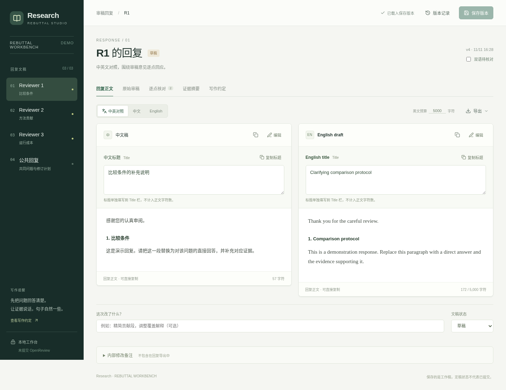
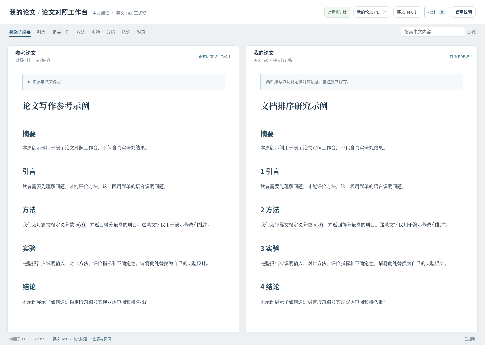

# Research Workbench

Two tools for the writing side of research: a bilingual rebuttal editor and a
side-by-side paper comparison workspace. Built from tools used in an actual
paper-writing workflow, with original fictional examples for this public release.

[中文说明](README.zh-CN.md) · [MIT license](LICENSE) · [Third-party notices](THIRD_PARTY_NOTICES.md)

## Rebuttal Workbench



- Chinese/English drafts with separate titles, Markdown previews and character budgets.
- Original reviews and translations, plus concern-to-response section mapping.
- Evidence cards, drafting notes and a bilingual alignment checklist.
- Persistent SQLite storage, optimistic revision checks and version restoration.
- Copy/export individual responses or download all drafts as JSON.

Requires **Node.js 22.13+** (24 LTS recommended) and npm:

```bash
cd apps/rebuttal
npm ci
npm run dev
```

Open **http://127.0.0.1:3000**. For a production build, run `npm run build`
then `npm start`. Both commands bind to loopback by default.

Customize reviewers and content in `app/seed.json`, `app/review-records.ts`,
`app/review-translations.ts` and `app/review-data.ts`. The included data is
fictional. See [rebuttal setup and storage](docs/rebuttal.md).

## Paper Comparison Workbench



- Two independently scrolling papers, linked by stable paragraph identifiers.
- English TeX as the source; reviewed Chinese translations tied to source hashes.
- Changed English invalidates stale translations and visibly falls back to English.
- Paragraph/selection/document annotations, revision checks, resolve and restore.
- Source-change tracking, Markdown comment export, local file watching and optional PDF builds.
- Tables, equations and figure zoom; MathJax is bundled for offline rendering.

Requires **Python 3.10+**, **Pandoc**, and optionally **TeX Live + latexmk** for PDFs.
On Debian/Ubuntu, install Pandoc with `sudo apt install pandoc`. PDF builds also
need `latexmk texlive-latex-recommended texlive-fonts-recommended`.

```bash
cd apps/paper-compare
python3 -m venv .venv
. .venv/bin/activate
pip install -r requirements.txt
python scripts/init_demo.py
python scripts/serve.py
```

Open **http://127.0.0.1:8767**. To build and watch PDFs as well:

```bash
python scripts/serve.py --pdf
```

Edit `workspace/draft/content.tex` and `workspace/reference/content.tex` in your
editor; the web page is a reading and annotation interface. Instructions for
paragraph markers, reviewed translations, figure files and optional local
machine translation are in [the paper tool guide](docs/paper-compare.md).

## Local data and deployment

These are **local, single-user tools**. No model API key, ChatGPT account,
Cloudflare database or external submission account is needed. They do not
submit to OpenReview or automatically rewrite a paper.

`apps/rebuttal/data/` and `apps/paper-compare/workspace/` are ignored by Git.
The applications have loopback/origin checks, not multi-user authentication.
Do not expose them directly to the public internet. Use a separately configured
authenticated gateway if you need remote access.

Source review files and seeds are client-visible application content. Keep
personal project copies private when replacing the examples. Never push actual
reviews, unpublished papers or secrets to this demonstration repository.

## Checks

```bash
cd apps/rebuttal
npm run typecheck
npm run build
# from apps/paper-compare, with the virtual environment active:
python -m unittest discover -s scripts -p 'test_*.py'
python scripts/build.py --pdf
```

See [testing](docs/testing.md) for API and browser smoke tests. Contributions
that improve portability, translation workflows and accessibility are welcome.
