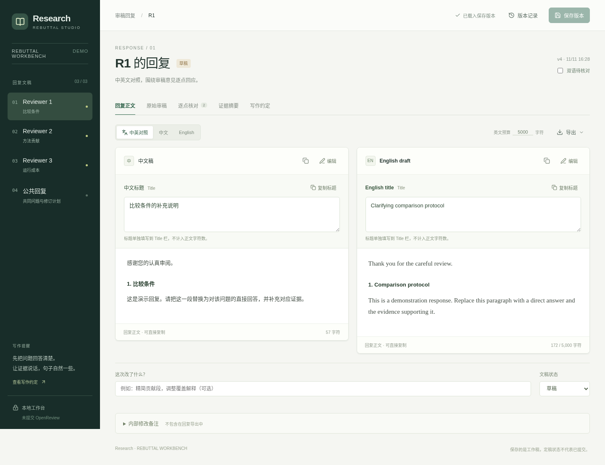
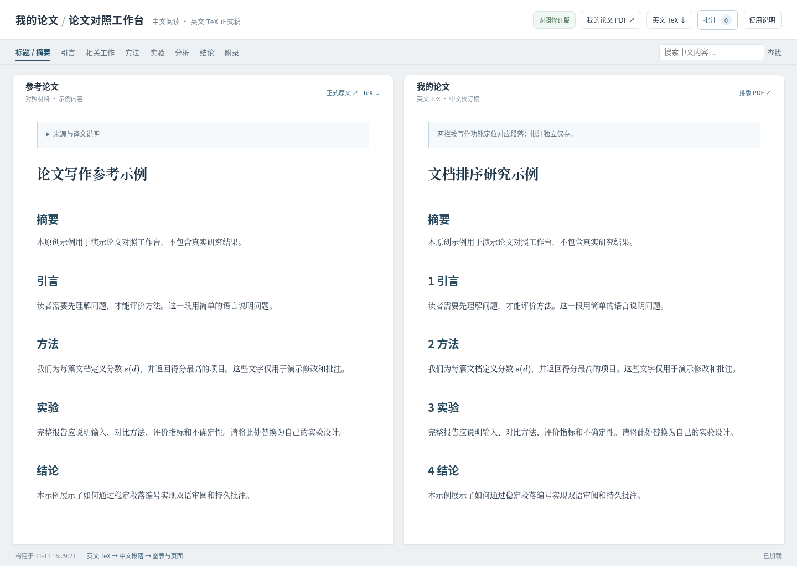

# Research Workbench · 研究写作工作台

把论文写作中实际使用的两个工具整理成可独立运行的开源版本：
**双语 rebuttal 工作台**和**论文对照修改工作台**。
仓库配有原创虚构示例，不包含实际论文、审稿内容、实验数据或私人批注。

[English](README.md) · [MIT 许可证](LICENSE)

## 双语 rebuttal 工作台



支持中英文并排编辑、标题与正文分离、字符预算、Markdown 预览、原始审稿
及译文、审稿问题与回复段落的对应检查、证据卡片、版本保存和恢复、复制与导出。
使用本地 SQLite 保存，多个窗口同时修改时会提示版本冲突。

安装 Node.js 22.13 或更新版本（推荐 24 LTS），然后运行：

```bash
cd apps/rebuttal
npm ci
npm run dev
```

打开 **http://127.0.0.1:3000**。
修改 `app/seed.json`、`app/review-records.ts`、`app/review-translations.ts` 和
`app/review-data.ts`，即可换成自己的审稿与回复。已有数据不会被修改初始示例自动覆盖。
详细说明见 [配置与存储](docs/rebuttal.md)。

## 论文对照修改工作台



左栏参考论文，右栏自己的论文；通过章节和稳定段落编号联动定位。
英文 TeX 是编辑源，中文译文绑定对应英文的哈希；英文变化后会提示译文需要更新。
支持选中文字批注、段落批注、整篇意见、解决与恢复、来源变化提示和 Markdown 导出。
页面负责阅读和批注，正文使用本地编辑器修改；文件变化后自动重建页面。

需要 Python 3.10+ 和 Pandoc。编译 PDF 另需 TeX Live 与 latexmk。

```bash
cd apps/paper-compare
python3 -m venv .venv
. .venv/bin/activate
pip install -r requirements.txt
python scripts/init_demo.py
python scripts/serve.py
```

打开 **http://127.0.0.1:8767**。如果需要同步生成 PDF，使用
`python scripts/serve.py --pdf`。详细操作见 [论文工作台指南](docs/paper-compare.md)。

两套工具均默认只在本机运行，无需模型 API、ChatGPT 或云端数据库账户。
本地数据库和论文工作目录已加入 `.gitignore`。自动翻译是可选功能；默认不下载模型，
也不调用在线翻译服务。工具不会向 OpenReview 提交回复。

代码采用 MIT 许可证，第三方组件沿用其原许可证。欢迎提交问题和改进。
